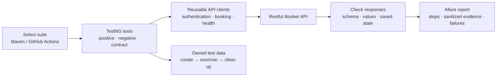

# Restful Booker API Automation

A Java API testing project for the complete [Restful Booker](https://restful-booker.herokuapp.com/) booking lifecycle, built with **TestNG, REST Assured, Maven, and Allure**.



[](https://github.com/kushagrasinha123ks/restful-bookerAPI-automation/actions/workflows/api-tests.yml)

## What this project demonstrates

- Coverage for **all eight documented operations**, including authentication, booking CRUD, filtering, and health checks.
- Positive, negative, boundary, response-schema, and complete booking lifecycle scenarios.
- Small API clients, typed booking models, reusable test-data builders, and TestNG data providers.
- Independent tests that create and clean up their own booking records.
- Group-based execution, sanitized HTTP evidence, and Allure HTML reports.
- GitHub Actions execution with report artifacts preserved after assertion failures.

This is a testing framework for a public practice application. The API intentionally contains bugs. Its established behavior and the stricter checks that expose known defects are documented separately; a green default run does not claim that the application has no defects.

Recorded live verification: **81 default tests passed**, with **six upstream defects reproduced separately**. See [verification details](docs/verification.md) for the environment, scope, and report commands.

## Quick start

Install **JDK 17 or newer** and Git. Maven is supplied through the checked-in Maven Wrapper; no global Maven or Allure installation is needed. The first run needs Internet access to download dependencies and contact the API.

```bash
git clone https://github.com/kushagrasinha123ks/restful-bookerAPI-automation.git
cd restful-bookerAPI-automation
./mvnw clean test
./mvnw allure:report
./mvnw allure:serve
```

On Windows, use `mvnw.cmd` in Command Prompt or `.\mvnw.cmd` in PowerShell in place of `./mvnw`.

The default run includes the normal API tests and local framework checks, and excludes the explicitly identified `known-defect` group. Tests run sequentially against the shared demo service. There is no automatic retry that can hide an intermittent failure.

## API coverage

| Operation | Method and path | Main checks |
|---|---|---|
| Health check | `GET /ping` | Availability and the application's HTTP 201 response |
| Create token | `POST /auth` | Valid credentials, token response, invalid or missing credentials |
| List / filter booking IDs | `GET /booking` | ID schema, owned-record lookup, name and date filtering |
| Read booking | `GET /booking/{id}` | Stored values, response schema, missing IDs and alternate formats |
| Create booking | `POST /booking` | Valid payloads, saved values, input variations and invalid requests |
| Replace booking | `PUT /booking/{id}` | Full replacement, authorization, validation, missing resource |
| Partially update booking | `PATCH /booking/{id}` | Changed and unchanged fields, authorization, missing resource |
| Delete booking | `DELETE /booking/{id}` | Authorization, deletion, subsequent GET returning 404 |

See [the test coverage matrix](docs/test-coverage.md) for scenarios and their test locations. "All eight operations" describes endpoint coverage, not a claim of exhaustive coverage of every possible input.

## Run a selected suite

| Command | Purpose |
|---|---|
| `./mvnw clean test` | Default suite, including framework checks; known-defect probes excluded |
| `./mvnw test -Dgroups=smoke` | Small set of essential API checks |
| `./mvnw test -Dgroups=regression` | API regression checks |
| `./mvnw test -Dgroups=negative` | Invalid inputs, missing records, and unauthorized requests |
| `./mvnw test -Dgroups=contract` | Response contracts and schemas |
| `./mvnw test -Dgroups=lifecycle` | Complete create/read/update/patch/delete journey |
| `./mvnw test -Dgroups=framework` | Local harness checks without calling the public API |

A test can have several groups. The table selects tests by those groups, rather than starting a separate framework for each suite.

To run the stricter probes for known application defects explicitly:

```bash
./mvnw clean test -Dgroups=known-defect -DexcludedGroups=
./mvnw allure:report
```

**These probes are expected to fail while the documented upstream defects remain.** They assert the desired contract instead of treating the defective response as correct. Normal negative tests also characterize established error responses, with those quirks explained in the documentation. See [API behavior and known defects](docs/api-behavior.md).

Use `clean` when you want a report containing only the next execution. Running `test` repeatedly without cleaning can retain earlier Allure result files.

## Configuration

Configuration uses Java system properties first, environment variables second, and project defaults last.

| Setting | System property | Environment variable | Default |
|---|---|---|---|
| API URL | `baseUrl` | `BOOKER_BASE_URL` | `https://restful-booker.herokuapp.com` |
| Username | `apiUsername` | `BOOKER_USERNAME` | Public demo username |
| Password | `apiPassword` | `BOOKER_PASSWORD` | Public demo password |
| Connect timeout | `connectTimeoutMs` | `BOOKER_CONNECT_TIMEOUT_MS` | `10000` milliseconds |
| Read timeout | `readTimeoutMs` | `BOOKER_READ_TIMEOUT_MS` | `20000` milliseconds |

```bash
# Run against your own compatible Restful Booker deployment.
BOOKER_BASE_URL=http://localhost:3001 ./mvnw clean test

# Override a nonsecret setting for one run.
./mvnw test -Dgroups=smoke -DreadTimeoutMs=30000
```

For private deployments, provide credentials through environment variables or CI secrets. Do not put private credentials into tracked configuration files. The framework reports redact credentials and authentication headers.

## Project structure

```text
.
├── .github/workflows/api-tests.yml  # CI and report artifacts
├── .mvn/wrapper/                   # Pinned Maven distribution
├── docs/                           # Coverage, architecture, and API observations
├── src/main/java/com/kushagra/booker/
│   ├── clients/                    # Auth, booking, and health HTTP operations
│   ├── config/                     # Environment and timeout configuration
│   ├── data/                       # Booking test-data builders
│   ├── models/                     # Request and response POJOs
│   └── reporting/                  # Allure steps and sanitized attachments
├── src/test/java/com/kushagra/booker/
│   ├── support/                    # Shared setup and owned-record cleanup
│   └── tests/                      # Endpoint, lifecycle, and framework tests
├── src/test/resources/schemas/     # Versioned response-schema expectations
├── mvnw / mvnw.cmd
└── pom.xml                         # Pinned dependencies and plugins
```

Clients describe HTTP operations; tests decide whether results are correct. Models keep payloads readable, data providers supply meaningful variations, and test support manages prerequisites and cleanup. See [architecture and design](docs/architecture.md) for the responsibilities and extension points.

## Allure reporting

After a test run:

```bash
./mvnw allure:report
```

| Output | Location |
|---|---|
| Raw Allure results and attachments | `target/allure-results/` |
| Generated HTML report | `target/site/allure-maven-plugin/index.html` |
| TestNG / Maven test results | `target/surefire-reports/` |

Use `./mvnw allure:serve` to generate and open a locally served report. The HTML application should be served over HTTP; opening `index.html` directly through `file://` can prevent its assets from loading correctly. For example, after `allure:report`, run `python3 -m http.server 8000 --directory target/site/allure-maven-plugin` and visit `http://localhost:8000`.

HTTP steps include sanitized request/response evidence to help reproduce failures. A later successful report-generation step does not change a failed test run into a successful one. Generated results are ignored by Git; CI artifacts keep execution evidence separate from source code.

## GitHub Actions

The [workflow](.github/workflows/api-tests.yml) runs the default suite on pushes and pull requests to `main`. You can also choose a group from **Actions → Booker API tests → Run workflow**.

The workflow installs Java 17, uses the Maven Wrapper, runs the selected suite, generates Allure HTML when results exist, and uploads raw results, generated HTML, and Surefire output. Download the run's artifact from GitHub Actions to inspect it. Artifacts are retained for 14 days; this workflow does not publish a public Pages site.

Action dependencies are pinned to full commit SHAs. A repository-wide concurrency group prevents this workflow from running several suites against the public API at once.

## Working with the public demo

The [service homepage](https://restful-booker.herokuapp.com/) states that data resets every ten minutes. Other learners also use the service. Tests therefore create their own records and never depend on a seeded booking ID or an exact global record count. Before cleanup, the fixture reads each owned ID and checks for a unique name marker generated by this run; it refuses deletion if ownership changed. The API offers no atomic conditional delete, so a narrow race between that check and deletion remains possible on this shared service. A reset can still interrupt a scenario; retain the evidence and investigate before rerunning.

Data persistence checks are performed through subsequent API reads. This project does not claim direct access to the hosted application's database. Use your own compatible deployment for more repeatable experiments or larger test volumes.

## Add or change a test

1. Read the endpoint contract and existing observations.
2. Add a focused scenario in the appropriate test class; give it useful TestNG groups.
3. Create prerequisites through the shared support layer so cleanup knows which IDs the test owns.
4. Assert exact status and meaningful response values, then read the resource again when verifying a write.
5. Run the affected group and inspect its Allure evidence. Update the coverage matrix when scope changes.

Avoid broad status-code alternatives, arbitrary sleeps, and assertions weakened only to make a failing build green. When a failure reveals an application defect, document the expected and actual behavior and add a focused reproducer.

## References

- [Restful Booker API documentation](https://restful-booker.herokuapp.com/apidoc/index.html)
- [Official generated API definitions](https://github.com/mwinteringham/restful-booker/blob/main/public/apidoc/api_data.json)
- [Official route implementation](https://github.com/mwinteringham/restful-booker/blob/main/routes/index.js)
- [REST Assured usage](https://github.com/rest-assured/rest-assured/wiki/Usage)
- [TestNG documentation](https://testng.org/)
- [Allure TestNG documentation](https://allurereport.org/docs/testng/)

The documentation UI can remain on a loading screen; its generated definitions and official source provide an alternate way to inspect each operation. Documentation and implementation can disagree, which is itself a testable finding.
