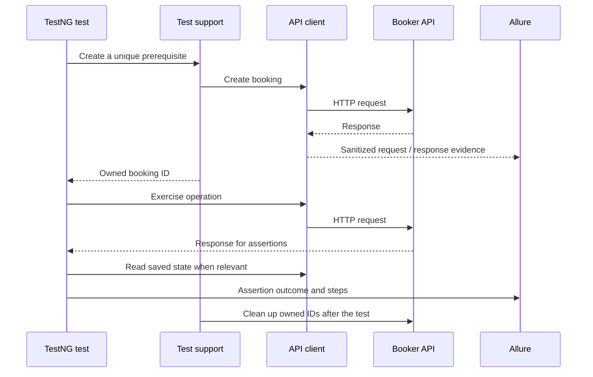

# Architecture and design

## Request flow

## Responsibilities

| Layer | Responsibility | What belongs elsewhere |
|---|---|---|
| `config` | Resolve URL, credentials, and finite timeouts | Endpoint assertions |
| `clients` | Build and send HTTP operations with reusable request configuration | Decide whether a scenario passed |
| `models` | Represent request/response structures as readable Java objects | Global mutable test state |
| `data` | Produce valid defaults and targeted payload variations | A fixed shared booking ID |
| `reporting` | Record steps and sanitized evidence | Retry or conceal failed assertions |
| Test `support` | Set up clients, track owned records, clean up | A dependency chain between test methods |
| `tests` | Express the scenario and expected results | Repeated low-level request plumbing |
| Response schemas | Describe expected response structure | Replace business-value assertions |

## Object-oriented design

The design uses small client objects and typed booking models. Composition keeps configuration and request/reporting behavior reusable across clients. Shared test support exists for lifecycle concerns, while each endpoint test remains understandable on its own. Builders supply valid payload defaults without forcing every test to repeat a large JSON string.

A request wrapper should not grow into a class with dozens of unrelated utility methods. Add a new abstraction when several scenarios share a real responsibility, not simply to make the folder tree look more elaborate.

## Isolation and cleanup

Each test creates data it needs and keeps track of the returned IDs. Tests do not change or delete the public service's seeded records. A new request specification is created for each request, avoiding headers, payloads, and authentication settings leaking into later calls.

Cleanup runs even when the test's assertion fails. If the application has already deleted a resource, cleanup must handle that without replacing the original failure. Unexpected cleanup failures should remain visible as evidence. Tests execute sequentially by default to reduce interference and traffic against the shared practice environment.

Booker can recycle identifiers after a reset. Cleanup reads the current resource and checks for a UUID name marker generated by this run before deleting it; a changed ownership marker causes a visible cleanup failure instead of deletion. The API has no atomic conditional-delete feature, so a narrow check/delete race remains on a shared deployment. Surefire uses TestNG's `configfailurepolicy=continue` so a cleanup failure does not skip unrelated scenarios.

## Assertions

- Check exact application-specific status codes.
- Check response media types and response structure where applicable.
- Compare submitted and returned booking values.
- Use a separate GET to verify that create/update/patch results were saved.
- After PATCH, verify fields outside the patch remain unchanged.
- After DELETE, verify the resource is no longer readable.
- For list and filter assertions, identify owned records rather than requiring a fixed global count or ordering.

Schema validation complements these checks. A structurally valid booking can still contain the wrong customer name or date.

## Reporting and failure handling

Allure is integrated through the TestNG adapter and runtime steps/attachments. No AspectJ weaving is needed. Requests and responses are sanitized before attachments are written. Authentication secrets do not belong in report titles or TestNG parameters.

Failures are not retried automatically: the Apache HTTP retry handler is also disabled, and an offline transport test verifies that a disconnected request is attempted once. Known application defects have an explicit group and reproducible strict assertions. The default suite's exclusions are visible in the README and Maven configuration. See [API behavior](api-behavior.md) for their rationale.

## Extending the framework

For a new scenario, reuse an existing client, model, and owned-data fixture before adding infrastructure. Extend the response schema only when the contract changes. Keep environment-specific values out of Java test methods. Validate a change with the affected group, then broaden execution when the change crosses several clients or support components.
